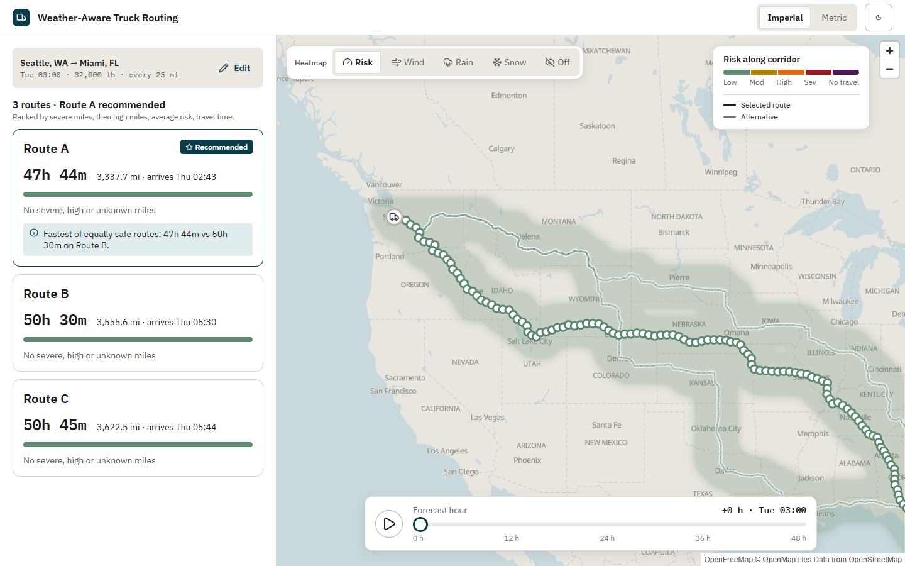

# Weather-Aware Truck Routing

**Live:** https://weather-aware-truck-routing-gamma.vercel.app

Plan a truck trip and see the weather **where the truck will be, when it gets there**. The app compares up to three truck routes and checks the forecast every 10, 25 or 50 miles at each checkpoint's ETA. It classifies the risk (with load rules for heavy cargo), recommends the safest route, and lets you scrub a 0–48 h weather heatmap with trucks moving along their routes.



- **Inputs:** origin and destination (US autosuggest), departure time in your time zone, and cargo or gross weight. Optional: empty-truck weight, axles, checkpoint spacing, and US hours-of-service rest breaks.
- **Routes:** TomTom truck routing with alternatives. If fewer than three come back, the app adds a via-point detour and says so.
- **Checkpoints:** each one gets an ETA, the hourly forecast (wind, gusts, rain, snow), a risk level and the rule that set it.
- **Recommendation:** routes are ranked by severe miles, then high miles, average risk and travel time, and the UI states the deciding factor.
- **Heatmap:** Risk, Wind, Rain or Snow over the corridor for every hour 0–48. Scrubbing is client-side only and holds 60 fps on a cross-country trip ([docs/PERF.md](docs/PERF.md)).
- **Display:** imperial or metric units, light or dark theme, and a phone layout with a bottom sheet.

## Architecture



| Part | What it does |
|---|---|
| `frontend/` | Vite + React 19 + TypeScript. MapLibre (OpenFreeMap tiles, no key) draws routes and checkpoints; a deck.gl `HeatmapLayer` is interleaved under the routes. Radix primitives, CSS Modules on design tokens (`src/tokens/tokens.ts`, exported from the Pencil design system), TanStack Query. |
| `backend/config/views.py` | DRF endpoints: input validation and orchestration. |
| `backend/tomtom.py` | Geocoding, autosuggest, truck routes (alternatives and via-point detours) and reverse geocoding. The API key never leaves the backend. |
| `backend/checkpoints.py` | Samples checkpoints along the polyline, interpolates ETAs from TomTom's progress keyframes, assigns each checkpoint the miles it owns, simplifies display paths, and computes HOS breaks and stops. Pure functions. |
| `backend/weather.py` | Open-Meteo hourly forecast in batched calls (50 locations each, 4 in parallel), retried with back-off on rate limits. An in-memory LRU cache holds each place's whole hourly series (lat and lon to 2 dp, at least 4 days), so re-planning the same places at other hours (HOS breaks, a new departure) needs no new calls. |
| `backend/risk.py`, `ranking.py`, `heatmap.py` | Classification and load rules, route ranking with the "why" text, and the corridor grid for the heatmap. Pure functions. |

One httpx client is shared per request by TomTom and Open-Meteo. There is no database.

## Run locally

You need Python 3.12+ and Node 24+, plus a free [TomTom developer key](https://developer.tomtom.com/) (no card needed).

Terminal 1, the backend (http://127.0.0.1:8000), from the repo root:

```sh
cd backend
python -m venv .venv
.venv/Scripts/pip install -r requirements-dev.txt     # macOS/Linux: .venv/bin/pip
cp .env.example .env                                  # then set TOMTOM_API_KEY=...
.venv/Scripts/python manage.py runserver              # macOS/Linux: .venv/bin/python
```

Terminal 2, the frontend (http://localhost:5173, proxies `/api` to :8000), from the repo root:

```sh
cd frontend
npm ci
npm run dev
```

### Tests and checks

| Command | What it covers |
|---|---|
| `cd backend && .venv/Scripts/pytest` | Every classification and load-rule edge, checkpoint sampling and mile attribution, ETAs, HOS breaks and stops, ranking, the heatmap grid, and API contracts with TomTom and Open-Meteo mocked at the HTTP boundary |
| `cd frontend && npm test` | App behavior through Testing Library: forms, states, results, units, theme, slider and heatmap controls, truck positions and token generation |
| `cd frontend && npm run typecheck && npm run lint:css` | TypeScript; Stylelint bans raw colors and px in CSS |
| `cd frontend && npx playwright install chromium && npm run e2e` | Playwright on the production build, desktop and phone, with `/api` answered by fixtures (`e2e/fixtures.ts`). A smoke test checks plan → 3 cards → scrub with no refetch, CLS < 0.1, no horizontal scroll and no page errors. **User journeys** (`e2e/journeys.spec.ts`) cover:<br>• planning: autosuggest by keyboard, example trip, Edit and re-plan, gross-weight warning, validation<br>• results: route detail, No Travel, all routes blocked, detours, HOS stops<br>• map: heatmap layers, scrubbing, Play/Pause<br>• recovery: no route, outage and Try again, weather Retry<br>• preferences: units and Undo, theme persistence<br>• phone: the bottom sheet |
| `cd frontend && LIVE_URL=https://… npm run e2e:live` | Live journeys against a deployment and the real TomTom + Open-Meteo APIs: autosuggest plan, HOS stops on a long trip, no route. Not in CI, because live data and rate limits would make it flaky |
| `cd frontend && node scripts/profile.mjs` | Cross-country frame-rate profile against the real backend ([docs/PERF.md](docs/PERF.md)) |

GitHub Actions runs the backend, frontend and e2e jobs on every pull request and on pushes to `main`.

## Deploy (Vercel)

There is one project, from the repository root. `vercel.json` builds `frontend/` as static files and serves Django as the Python function `api/index.py` (`maxDuration` 60 s, since long trips take 15–40 s). `/api/*` goes to Django and everything else goes to the SPA.

- **`"framework": null` is required.** Without it, Vercel detects a Python backend framework, routes every request to Django, and skips the Python dependency install.
- **Python dependencies live in the root `requirements.txt`.** Vercel can't follow `-r` includes, so `backend/requirements.txt` includes the root file instead.
- **`.vercelignore`** keeps `backend/.env` and local virtualenvs out of the upload.

To deploy from a clone: run `npx vercel link`, add the variables below with `npx vercel env add NAME production`, then run `npx vercel deploy --prod`.

Set these environment variables: `SECRET_KEY`, `DEBUG=false`, `ALLOWED_HOSTS=.vercel.app` and `TOMTOM_API_KEY`.

## Rules and assumptions

These are the rules agreed in [docs/SPEC.md](docs/SPEC.md), plus decisions made during the build (HOS breaks, the 50 mi heatmap fallback, the detour offsets). This section is the current, complete set; the code implements exactly these.

### Risk classification

Thresholds are in imperial units. Each band includes its lower bound and excludes its upper bound.

| Level | Sustained wind (mph) | Rain (in/hr) | Snow (in/hr) |
|---|---|---|---|
| Low | < 25 | < 0.10 | < 0.5 |
| Moderate | 25 – 35 | 0.10 – 0.25 | 0.5 – 1.0 |
| High | 35 – 45 | 0.25 – 0.50 | 1.0 – 2.0 |
| Severe | 45 – 55 | 0.50 – 1.00 (inclusive) | 2.0 – 3.0 (inclusive) |
| No Travel | ≥ 55 | > 1.00 | > 3.0 |

- **Checkpoint level:** the worst of wind, rain and snow. Load rules can only raise it:
  - wind 45–55 mph with **cargo > 30,000 lb** → No Travel
  - wind 35–45 mph with **cargo > 40,000 lb** → Severe

  The weight limits are strict, so exactly 30,000 lb is not raised.
- **Wind:** sustained wind (`wind_speed_10m`) classifies. Gusts are shown for information only.
- **Rain and snow:** Open-Meteo's rain (mm) and snowfall (cm) are converted to inches and **rounded at the conversion**, so a reading never flips a band through float error.
- **Missing or NaN values:** the checkpoint is Unknown. It shows grey, is reported as unknown miles, and is left out of the average.
- **Negative values** are clamped to 0.
- **Past the forecast horizon** (16 days): the last available hour is used and flagged "beyond forecast".

### Checkpoints, ETAs and miles

- **Placement:** checkpoints sit at the origin (mile 0), then every 10, 25 or 50 mi along the route, plus one at the destination.
- **ETAs:** interpolated from TomTom's own distance and travel-time keyframes, which use the truck profile, the weight and historical traffic for the departure time. Mileposts are scaled to TomTom's route length.
- **Mile attribution:** each checkpoint owns half the gap to each neighbor (nearest-checkpoint attribution). Route summaries add up owned miles per level.
- **Times:** shown in the browser's time zone, with elapsed time since departure. Departures in the past are rejected.

### Weight

- **Cargo only (default):** TomTom gets cargo plus the empty-truck weight (default 35,000 lb).
- **Gross:** TomTom gets the gross weight, and cargo = gross − empty truck (never below 0).
- **Load rules** always use cargo.
- **Axle count and weight per axle** are sent to TomTom only when set.
- **Over 80,000 lb gross:** the app warns but still plans.

### Recommendation

- **No Travel:** a route with any No Travel mile ranks last and gets a banner. If every route is blocked, nothing is recommended.
- **Ranking:** routes are ordered by severe miles, then high miles, then mile-weighted average risk (0–4), then travel time. Miles are rounded to 0.1. The UI states the deciding factor against Route B.
- **Fewer than 3 routes:** if TomTom returns fewer than three, the app adds via-point detours (±15% / ±30% off the midpoint). Duplicates are dropped, and the UI explains detours or the shortfall.

### Hours of service (optional)

- **When off (default):** ETAs assume non-stop driving.
- **When on:** a simplified US property-carrying rule (49 CFR 395.3) applies:
  - a 30 min break once a shift's driving passes 8 h
  - a 10 h rest after 11 h of driving
- **What shifts:** checkpoint ETAs, the hour weather is checked at, truck positions and the arrival all move with the stops.
- **Stops:** each route lists where the driver stops (milepost, nearest town, time). Stops also show on the map.
- **Not modeled:** the 14 h on-duty window, the 60/70 h weekly limits and sleeper-berth splits. Stops go where the driving clock runs out, not at a real truck stop.

### Heatmap

- **Grid:** cells sit on a fixed ~25 mi lattice within 50 mi of any route checkpoint. Past 500 cells it widens to 50 mi, which keeps long corridors inside Open-Meteo's free tier of about 600 locations a minute.
- **Hours:** 49 hours from the departure hour, fetched once. The slider only indexes into that one response.
- **Layers:** Risk uses the cargo load rules. Wind, Rain and Snow each classify their own variable alone.
- **Unknown cells** draw no heat.

### Units and display

- **Units:** the backend is always imperial; the frontend converts for display only. Metric rule text keeps the original threshold too, for example "40.2 km/h (25 mph)". The choice is remembered and defaults from the locale.
- **Theme:** light by default; dark when chosen, and remembered.
- **Risk colors** come from a colorblind-safe ramp and are always paired with an icon and a label.

## API

All endpoints are JSON. Validation errors return `400 {field: [message]}`. Weights must be ≥ 0, and `axle_weight_lb` ≥ 1.

### `POST /api/plan`

Request:

```json
{
  "origin": "Denver, CO",
  "destination": "Chicago, IL",
  "departure": "2026-10-21T14:00:00Z",
  "weight_lb": 32000,
  "weight_mode": "cargo",
  "empty_truck_lb": 35000,
  "axle_count": 5,
  "axle_weight_lb": 20000,
  "interval_mi": 25,
  "hos": true,
  "origin_position": [39.74, -104.99],
  "destination_position": [41.88, -87.63]
}
```

| Field | Notes |
|---|---|
| `origin`, `destination`, `departure`, `weight_lb` | Required. `departure` must be in the future. |
| `weight_mode` | `cargo` (default) or `gross` |
| `empty_truck_lb` | Default 35,000 |
| `axle_count`, `axle_weight_lb` | Optional. `axle_count` is 2–12. |
| `interval_mi` | 10, 25 (default) or 50 |
| `hos` | Default false |
| `origin_position`, `destination_position` | Optional `[lat, lon]` from autosuggest. They skip text geocoding. |

Response `200`:

```json
{
  "routes": [{
    "name": "Route A", "distance_mi": 1003.4, "duration_s": 54900, "trip_s": 92700,
    "synthesized": false, "detour_via": null,
    "summary": { "severe_mi": 0, "high_mi": 12.5, "unknown_mi": 0, "notravel_mi": 0, "avg_risk": 0.3 },
    "checkpoints": [{ "mile": 25, "lat": 39.9, "lon": -104.6, "offset_s": 1500, "eta": "…Z",
      "level": 2, "reasons": ["wind 38 mph: High"], "beyond_forecast": false,
      "wind_mph": 38, "gust_mph": 52, "rain_in_hr": 0, "snow_in_hr": 0, "owned_mi": 25 }],
    "segments": [{ "level": 2, "coordinates": [[-104.99, 39.74], …] }],
    "stops": [{ "kind": "rest", "mile": 660.4, "lat": 41.1, "lon": -98.9, "offset_s": 41400,
      "start": "…Z", "duration_s": 36000, "place": "Grand Island, NE" }]
  }],
  "recommended": 0,
  "why": "Wins on high miles: 12.5 mi vs 48.0 mi on Route B (both 0 severe).",
  "routes_found": 3,
  "cargo_lb": 32000
}
```

| Field | Meaning |
|---|---|
| `routes` | Best first. `recommended` is `0`, or `null` when every route is blocked. |
| `level` | 0 Low … 4 No Travel; `null` is Unknown |
| `duration_s` | Driving time |
| `trip_s` | Departure to arrival, including HOS stops |
| `offset_s` | Wall-clock seconds after departure |
| `stops` | Empty unless `hos` is true |
| `summary.avg_risk` | `null` when every mile is Unknown |

Errors:
- `422 {detail}`: a place wasn't found, or there is no route. No route adds `"code": "no_route"`.
- `502 {detail}`: TomTom is unreachable.

### `POST /api/heatmap`

Request: `{ points: [[lat, lon]…] (1–2,000, every route's checkpoints), departure, cargo_lb }`

Response: `{ hours: [49 ISO hours], spacing_mi: 25 | 50, cells: [[lon, lat]…], levels: { risk, wind, rain, snow: [hour][cell] → 0–4 | null } }`

Errors:
- `400` on `points` when the corridor is too large even at 50 mi
- `502 {"detail": "Weather layer didn't load."}` when every reading is Unknown

### `GET /api/geocode?q=`

Returns `{ suggestions: [{ label, kind, lat, lon }] }`: TomTom typeahead, US only, 5 results. Fewer than 3 characters gives `[]`. Returns `502` if TomTom fails. It is throttled to 30 requests a minute per IP (`429`).

## Docs

- [docs/SPEC.md](docs/SPEC.md): the agreed spec
- [docs/PERF.md](docs/PERF.md): the performance profile
- [FUTURE_FEATURES.md](FUTURE_FEATURES.md)
- [LOOM_SCRIPT.md](LOOM_SCRIPT.md): the walkthrough script
- `design/truck-routing.pen`: the design system and screens, in Pencil
- [docs/PATTERNS_REVIEW.md](docs/PATTERNS_REVIEW.md): the mistakes log and the rules it produced
